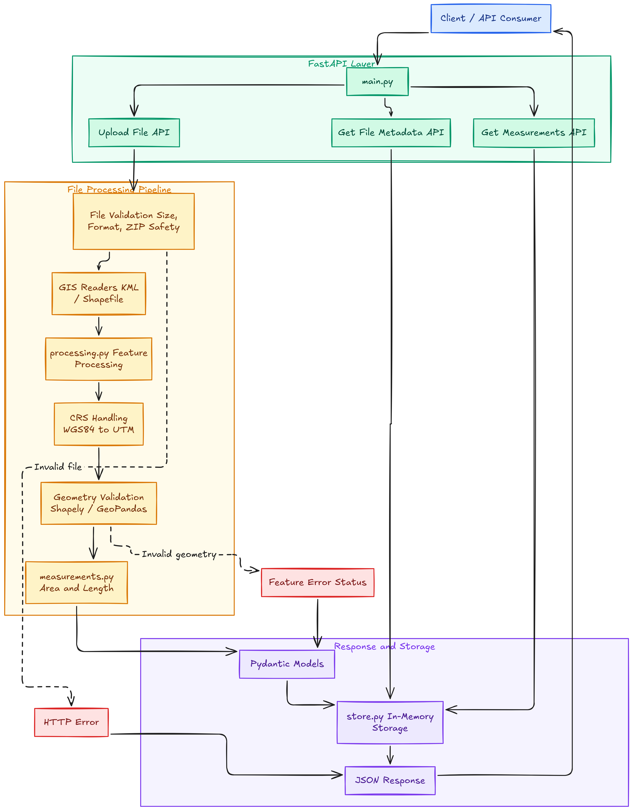

# Geospatial File Measurement API

A REST API built with **FastAPI** to calculate the area of polygon features and the length of line features from KML and zipped Shapefile files. It handles coordinate reference systems (CRS), validates uploaded files, and returns structured JSON results.

## Key Features

- **File Support:** Accepts KML files and ZIP archives containing Shapefiles.
- **Area Calculation:** Calculates polygon areas in square metres (m²).
- **Length Calculation:** Calculates line lengths in metres (m).
- **CRS Handling:** Transforms coordinates into a suitable UTM projection before measurement.
- **Input Validation:** Validates file formats, archive contents, geometries, and resource limits.
- **Feature-level Results:** Identifies measured, skipped, unsupported, and invalid features.
- **REST API:** Provides file metadata and measurement results through JSON responses.

## Architecture


## Project Structure

```text
geospatial-file-measurement-api/
├── app/
│   ├── main.py
│   ├── readers.py
│   ├── measurements.py
│   ├── processing.py
│   ├── schemas.py
│   └── store.py
├── tests/
│   ├── fixtures/
│   └── generate_fixtures.py
├── requirements.txt
└── README.md
```

| File | Responsibility |
|---|---|
| `main.py` | FastAPI application and API endpoints |
| `readers.py` | File validation, archive handling, and GIS reading |
| `measurements.py` | CRS handling and geometry measurements |
| `processing.py` | Coordinates the processing pipeline and builds results |
| `schemas.py` | Defines request and response data models |
| `store.py` | Stores completed results in memory |
| `tests/` | Contains automated tests and sample GIS files |

## Installation and Setup

**Prerequisites:** Python 3.12 or later and Git.

**1. Clone the repository**

```bash
git clone https://github.com/madhan-init/geospatial-file-measurement-api.git
cd geospatial-file-measurement-api
```

**2. Create a virtual environment**

```bash
python -m venv .venv
```

Activate it on Windows:

```bash
.venv\Scripts\activate
```

On macOS or Linux:

```bash
source .venv/bin/activate
```

**3. Install dependencies**

```bash
python -m pip install -r requirements.txt
```

**4. Start the API**

```bash
python -m uvicorn app.main:app --host 127.0.0.1 --port 8000 --workers 1
```

The API will be available at `http://127.0.0.1:8000`.

Interactive API documentation: `http://127.0.0.1:8000/docs`

## API Documentation and Examples

All upload requests use `multipart/form-data` with the field name `file`. Use the exact endpoint paths, including trailing slashes.

| Method | Endpoint | Description |
|---|---|---|
| `POST` | `/api/files/` | Upload and process a GIS file |
| `GET` | `/api/files/{id}/` | Retrieve file metadata |
| `GET` | `/api/files/{id}/measurements/` | Retrieve feature measurements |

### Upload a File

```bash
curl -X POST "http://127.0.0.1:8000/api/files/" \
  -F "file=@tests/fixtures/sample.zip"
```

**Example response:**

```json
{
  "id": "c35c3891-3f3d-4867-a4ca-1a69546eef4c",
  "filename": "sample.zip",
  "status": "COMPLETED",
  "feature_count": 1,
  "crs": "EPSG:32632",
  "counts": {
    "measured": 1,
    "skipped": 0,
    "unsupported": 0,
    "error": 0
  }
}
```

### Retrieve Measurements

Use the UUID returned by the upload endpoint.

```bash
curl "http://127.0.0.1:8000/api/files/YOUR_FILE_ID/measurements/"
```

**Example feature result:**

```json
{
  "geometry_type": "Polygon",
  "status": "measured",
  "measurement": {
    "kind": "area",
    "value": 10000.0,
    "unit": "m2",
    "crs": "EPSG:32632",
    "method": "utm"
  },
  "reason": null,
  "feature_id": 0,
  "layer": "dataset",
  "properties": {
    "name": "UTM square",
    "source_id": 42
  }
}
```

### Error Responses

| HTTP Status | Description |
|---|---|
| `400` | Unsupported file extension |
| `413` | Upload or resource limit exceeded |
| `422` | Invalid file, unsafe archive, or missing required CRS |
| `404` | File ID not found |
| `503` | In-memory result store is full |

## Testing

Install the testing dependencies:

```bash
python -m pip install pytest httpx
```

Run the test suite:

```bash
python -m pytest -q
```

The repository documents **96 passing tests** covering measurement calculations, CRS transformations, file validation, error handling, API endpoints, resource limits, and concurrent storage operations.

## Limitations

- Measurements are two-dimensional and intended for regional geographic extents.
- The API uses a suitable UTM projection and does not guarantee worldwide or survey-grade accuracy.
- Invalid geometries are reported rather than automatically repaired.
- Results are stored in memory and are cleared when the application restarts.
- Run with one worker to keep API requests and stored results within the same process.

